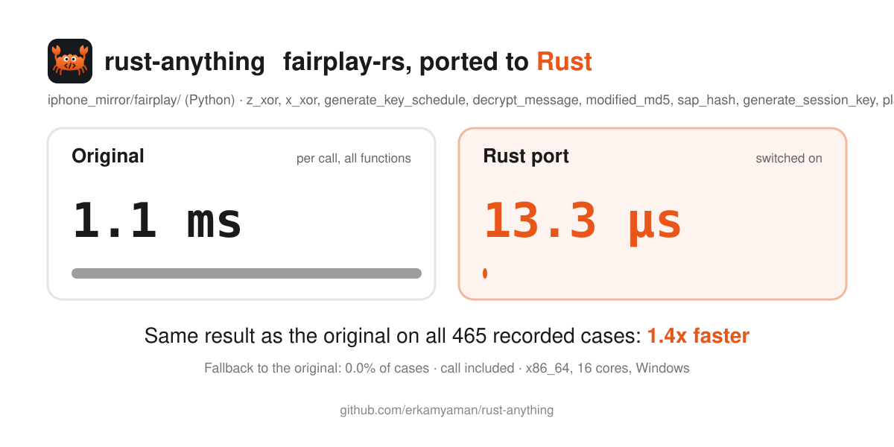

## `fairplay-rs` in Rust

| | |
| --- | --- |
| Unit | `iphone_mirror/fairplay/` (Python) |
| Recorded cases matched | 465 / 465 |
| Speedup, call included | 1.4x (geometric mean) |
| Fallback to the original | 0.0% (0 of 465 cases) |
| Switched on | on |

| Function | Cases | Original per call | Rust per call | Speedup |
| --- | ---: | ---: | ---: | ---: |
| `z_xor` | 12 | 837 ns | 1.2 µs | 1.4x slower |
| `x_xor` | 12 | 879 ns | 1.2 µs | 1.4x slower |
| `generate_key_schedule` | 12 | 1.4 µs | 1.4 µs | 1.0x slower |
| `decrypt_message` | 12 | 536 ns | 1.3 µs | 2.5x slower |
| `modified_md5` | 87 | 694 ns | 1.4 µs | 2.0x slower |
| `sap_hash` | 12 | 1.2 µs | 1.2 µs | 1.0x |
| `generate_session_key` | 89 | 689 ns | 1.3 µs | 1.9x slower |
| `playfair_decrypt` | 229 | 1.1 ms | 4.3 µs | 252x |

Measured with `rust-anything report` on x86_64, 16 cores, Windows: `diff` replays every recorded case, `bench` times them on both sides as callers call them. Reproduce: `rust-anything diff` and `rust-anything bench` in the crate folder.
