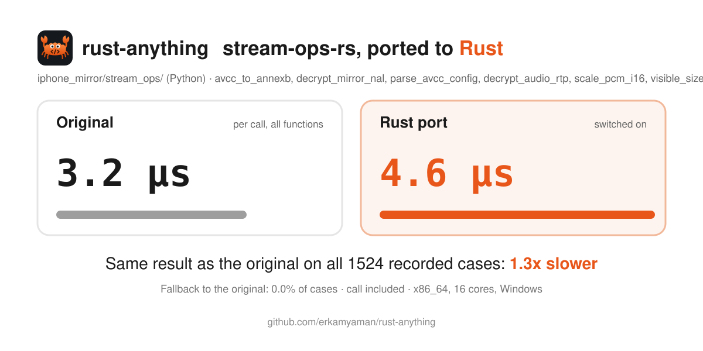

## `stream-ops-rs` in Rust

| | |
| --- | --- |
| Unit | `iphone_mirror/stream_ops/` (Python) |
| Recorded cases matched | 1524 / 1524 |
| Speedup, call included | 1.3x slower (geometric mean) |
| Fallback to the original | 0.0% (0 of 1524 cases) |
| Switched on | on |

| Function | Cases | Original per call | Rust per call | Speedup |
| --- | ---: | ---: | ---: | ---: |
| `avcc_to_annexb` | 208 | 272 ns | 184 ns | 1.5x |
| `decrypt_mirror_nal` | 227 | 714 ns | 1.1 µs | 1.6x slower |
| `parse_avcc_config` | 207 | 114 ns | 166 ns | 1.5x slower |
| `decrypt_audio_rtp` | 226 | 589 ns | 1.1 µs | 1.9x slower |
| `scale_pcm_i16` | 217 | 628 ns | 517 ns | 1.2x |
| `visible_size` | 234 | 161 ns | 178 ns | 1.1x slower |
| `encode_txt_records` | 205 | 718 ns | 1.3 µs | 1.8x slower |

Measured with `rust-anything report` on x86_64, 16 cores, Windows: `diff` replays every recorded case, `bench` times them on both sides as callers call them. Reproduce: `rust-anything diff` and `rust-anything bench` in the crate folder.
